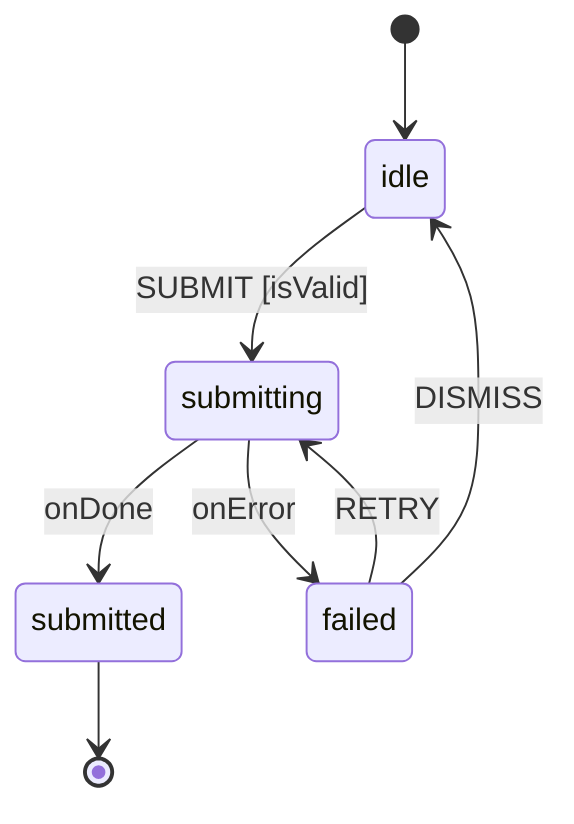

## Render the Machine as a Diagram

**Impact: HIGH**

A statechart's main advantage over scattered handlers is that a human can
*look* at it — which is worth nothing if the picture and the machine have
drifted apart.

### The contract

**Render or update the diagram whenever a machine is designed or changed, even
when nobody asked for one**, and render on request at any time. **The render
is a file in the repository, not a message.** Write the fenced `mermaid` block
either into a markdown file beside the machine or into a comment at the top of
the machine file itself, then name that path in your reply. A chart that
exists only in the reply is not a render — it leaves with the conversation,
and the next reviewer opens the machine with no diagram at all.

Regenerating on every change is what keeps the diagram from going stale, so it
is not optional work at the end — it is part of changing the machine. A
committed diagram left behind after the machine changed is a picture a
reviewer will trust and the code no longer matches.

Derive it from the machine source, never from memory of it, and regenerate
from the *final* definition once the change is complete. Report the validation
result honestly: say whether the diagram was checked to render, and never
claim a render that was not performed. (Where a diagrams skill is installed,
it owns format choice and validation tooling; treat it as optional — the rules
here are self-sufficient.)

### Format

Render as Mermaid `stateDiagram-v2`:

- One node per finite state; nested states become `state parent { ... }`;
  parallel regions are separated by `--`.
- Label every edge with its event, and append `[guard]` where a guard gates it.
- Show `onDone`/`onError` for invoked actors — the error path is the half
  reviewers most need to see.
- Keep it to one flow. A diagram spanning an actor system is a system diagram,
  and needs the wider care a system diagram deserves.
- Keep composite and concurrent boundaries legal, and keep parser-sensitive
  labels safe — an event name containing a colon, a guard containing a
  bracket, or a state name Mermaid reads as a keyword all need escaping or
  renaming in the label.

### Relationship to live tools

Stately Studio and `@statelyai/inspect` render the live machine and remain the
better loop for interactive exploration — Mermaid loses that interactivity,
which is the one real thing it costs — but a checked-in Mermaid render is what
makes the machine reviewable in a diff. Gate the inspector to dev builds; a
static import or production wiring of inspection is an anti-pattern
(`references/actors-and-systems.md`).

### Checklist

- [ ] Diagram regenerated from the machine's final definition after the change
- [ ] Written to a file in the repository, path named in the reply
- [ ] Every edge labelled; guards shown; `onDone`/`onError` visible
- [ ] Composite and concurrent boundaries legal; parser-sensitive labels safe
- [ ] Validation result reported accurately — never claim a render not performed
- [ ] No stale committed diagram left behind
